# Büyü Fısıltısı

Kocaeli Üniversitesi, Teknoloji Fakültesi, Bilişim Sistemleri Mühendisliği
Yazılım Geliştirme Laboratuvarı-I, Proje-1

**Ekip:** İnci Gören, Feyza Atilla
**Tarih:** Kasım 2026

## İçindekiler

1. [Giriş](#1-giriş)
2. [Kurulum ve çalıştırma](#2-kurulum-ve-çalıştırma)
3. [Sistem tasarımı](#3-sistem-tasarımı)
4. [Otonom yardımcı: Fısıl](#4-otonom-yardımcı-fısıl)
5. [Yerel LLM destekli NPC: Yaşlı Meşe](#5-yerel-llm-destekli-npc-yaşlı-meşe)
6. [Hata yönetimi](#6-hata-yönetimi)
7. [Testler ve sonuçlar](#7-testler-ve-sonuçlar)
8. [Ekran görüntüleri](#8-ekran-görüntüleri)
9. [Sonuç ve tartışma](#9-sonuç-ve-tartışma)

## 1. Giriş

### Problem ve amaç

Projenin amacı, tek bir Unity macera oyununda birbirinden bağımsız iki yapay zekâ bileşenini uçtan uca bir araya getirmektir:

1. **NavMesh tabanlı otonom bir yardımcı karakter.** Oyuncunun tek başına aşamadığı fiziksel bir engeli kendi yolunu bularak çözer.
2. **Yerel bir dil modeliyle konuşan NPC.** Oyuncu onunla serbest metinle konuşur. Modelin yapılandırılmış (JSON) çıktısı güvenli biçimde ayrıştırılır ve oyunun durumunu değiştirir.

İki bileşen de bulut servisine bağlı değildir. Dil modeli Ollama üzerinden oyuncunun bilgisayarında çalışır.

### Oyun senaryosu

Genç bir cadı karanlık bir ormanda yolunu kaybeder. Ona konuşan, eski bir büyü kitabı olan **Fısıl** eşlik eder. Orman bir cadının ihanetiyle susturulmuştur ve Orman Kalbi'nin kapısı mühürlüdür.

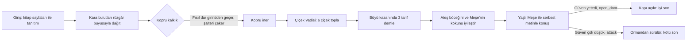

- **Fiziksel engel:** Girişteki uçurumun üstündeki köprü kalkıktır. Köprüyü indiren şalter, cadının sığamadığı dar bir girintinin içindedir. Oyuncu Büyü Kitabı'nı (Tab) açıp Fısıl'a emir verir. Fısıl NavMesh ile yolunu bulur, girintiye girer ve şalteri çeker.
- **Ara bölüm:** Bulut dağıtma, çiçek toplama ve demleme, yaralı ateş böceği ve kök, Gölge Tilki, gizli girdabın altındaki tuzaklı kök mağarası ve taş bulmacası. Yapılan her iyilik bir "iyilik kaydı" olarak tutulur ve Meşe'ye aktarılır.
- **Son aşama:** Yaşlı Meşe kapıyı korur ve cadılara güvenmez. Oyuncu onu sözleriyle ve yaptığı iyiliklerle ikna etmelidir. Meşe'nin yanıtı ve verdiği karar yerel dil modelinden gelir.

## 2. Kurulum ve çalıştırma

### Gereksinimler

- Unity 6.3 LTS (6000.3.25f1), Universal 3D (URP)
- Paketler: AI Navigation, Input System, TextMeshPro, Test Framework
- [Ollama](https://ollama.com/) ve `gemma2:2b` modeli ([model seçim notu](Docs/model_secimi.md))

### Adımlar

```bash
ollama pull gemma2:2b
ollama serve
```

1. Projeyi Unity Hub ile açın.
2. `Assets/_Project/Scenes/MainMenu.unity` sahnesini açıp Play'e basın.
3. Ollama kapalıysa oyun yine açılır. Meşe ekranındaki bağlantı göstergesi durumu ve ne yapılması gerektiğini söyler.

### Kontroller

| Tuş | İşlev |
|---|---|
| W A S D / ok tuşları | Yürü |
| Sol Shift | Koş |
| Boşluk | Zıpla |
| Fare | Kamerayı çevir |
| Sol tık / R | Rüzgâr büyüsü (bulut dağıt, tilkiyi sakinleştir) |
| Tab | Büyü Kitabı: Fısıl'a emir ver, tarifleri gör |
| F / G / B | Fısıl: yanıma gel / bekle / şalteri çek |
| E | Yaşlı Meşe ile konuş |
| Esc / P | Duraklat |

## 3. Sistem tasarımı

### Katmanlar

Kod, birbirine yalnızca izin verilen yönde bağımlı olan Assembly Definition'lara ayrılmıştır. `Core` hiçbir oyun koduna bağımlı değildir. Fısıl (`Companion`) ile Meşe (`LLM`) birbirini hiç tanımaz. İkisi arasındaki tek bağ `Core`'daki olaylar ve arayüzlerdir.

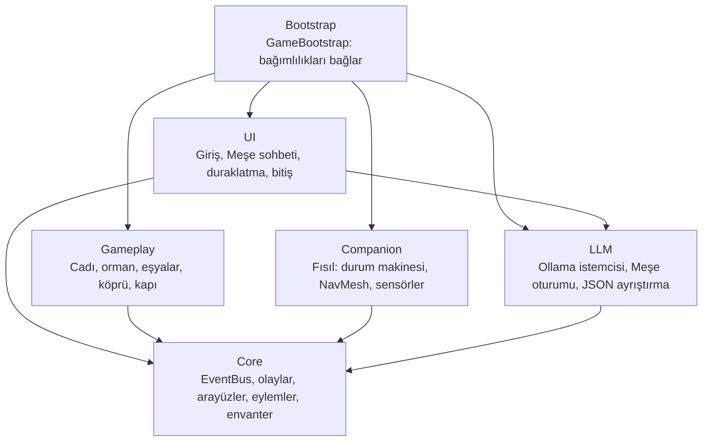

### Kullanılan OOP ilkeleri ve tasarım desenleri

| Desen / ilke | Nerede | Neden |
|---|---|---|
| Observer (olay yolu) | `IEventBus`, `EventBus`, `Core/GameEvents` | Köprü, kapı, görevler, sesler ve Meşe birbirini tanımadan haberleşir. |
| Bağımlılık enjeksiyonu | `IRequiresEventBus`, `GameBootstrap` | Bileşenler olay yolunu kendileri aramaz; açılışta verilir, testte sahtesi verilebilir. |
| Command | `CompanionCommand`, `ICompanionCommandIssuer/Receiver` | Oyuncunun emri bir nesnedir; klavye, kitap ya da test aracı aynı emri gönderebilir. |
| State Machine | `CompanionBrain`, `CompanionStateId` | Fısıl'ın kararları açık durumlar ve geçişlerle verilir. |
| Strategy / Factory | `IGameAction`, `GameActionFactory` | Modelin `action` alanı somut bir oyun eylemine çevrilir; yeni eylem eklemek diğer kodu değiştirmez. |
| Null Object | `NoAction`, `OakResponse.Fallback` | Geçersiz ya da eksik yanıtta `null` kontrolü yerine güvenli bir varsayılan döner. |
| Arayüzle soyutlama | `IHttpTransport`, `IRaycaster`, `ICompanionBody`, `IInteractable` | Unity'ye bağlı parçalar arayüz arkasındadır; mantık Unity olmadan birim testlerle sınanır. |
| Tek sorumluluk | `OakResponseParser`, `OakTrust`, `OakResponseGate`, `OakClaimGuard`, `OakToneGuard` | Ayrıştırma, güven hesabı, kapı kuralı ve yalan tespiti ayrı sınıflardadır. |

## 4. Otonom yardımcı: Fısıl

Fısıl bir `NavMeshAgent` ile hareket eder. Ortamdaki her şey NavMesh'e işlenir; Fısıl'ın ajan tipi küçük olduğu için cadının giremediği dar girintiye girebilir. Hiçbir hareketi önceden kaydedilmiş bir yol değildir: hedef her emirde `NavMesh.SamplePosition` ile NavMesh'e oturtulur ve yol o anki konumdan hesaplanır.

### Karar mantığı (durum makinesi)

`CompanionBrain` Unity'den bağımsız, saf bir C# sınıfıdır. `ICompanionBody` arayüzü üzerinden hareket eder, bu sayede birim testlerle sınanır.

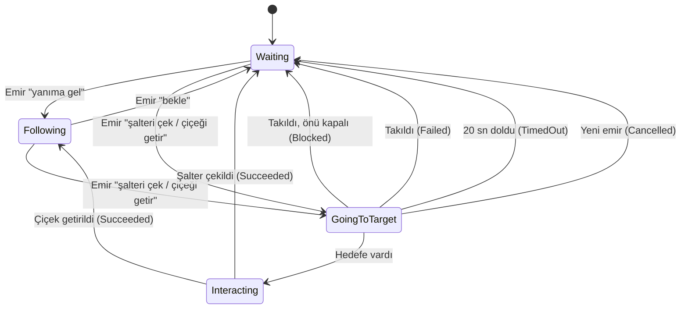

### Bir emrin akışı

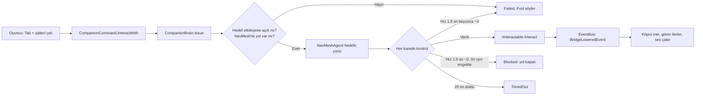

### Sensörler

| Sensör | Ne ölçer | Nasıl |
|---|---|---|
| `ObstacleSensor` | Öndeki engelin mesafesi ve yönü | Sol, orta ve sağ olmak üzere üç ışın (Raycast); menzil 1.5 m, yan açı 35° |
| `TargetSensor` | Hedefe olan mesafe ve açı | Yatay düzlemde mesafe ve işaretli açı (`Vector3.SignedAngle`) |
| `StuckDetector` | Takılma | NavMesh hızı 0.05 m/sn'nin altında 1.5 sn kalırsa |

Üç sensör de `CompanionController` içinde Fısıl'a bağlıdır. Fısıl hedefe giderken (`GoingToTarget`) her karede öndeki üç ışın ve hedefe olan mesafe ile açı okunur. Fısıl takıldığında orta ışın bir engele çarpıyorsa ve bu engel hedeften daha yakındaysa görev `Blocked` ("yol kapalı") ile biter; değilse `Failed` olur. Bu karar `CompanionController.PathBlocked` içinde, sensör okumalarından hesaplanır.

Sensörler `ISensor<T>` arayüzünü uygular ve fizik çağrısı `IRaycaster` arkasındadır, bu yüzden birim testleriyle doğrulanırlar. Görsel sınaması `InciSensorTest` sahnesinde yapılmıştır (bkz. [ekran görüntüleri](#8-ekran-görüntüleri)).

## 5. Yerel LLM destekli NPC: Yaşlı Meşe

### Model

`gemma2:2b`, Ollama üzerinde tamamen yerel çalışır. `llama3.2:3b` ile aynı istek biçimiyle karşılaştırılmıştır: ikisi de JSON'u hiç bozmamış (15/15), Gemma yaklaşık %15 daha yavaş ama Türkçesi belirgin biçimde daha temiz çıkmıştır (15/15'e karşı 10/15). Ayrıntılar: [Docs/model_secimi.md](Docs/model_secimi.md).

| Ayar | Değer |
|---|---|
| Uç nokta | `POST http://localhost:11434/api/chat` |
| Biçim | `format: "json"`, `stream: false` |
| Sıcaklık | 0.7 |
| Zaman aşımı | 90 sn |

### Kişilik ve sistem promptu

Sistem promptu her konuşma turunda `OakPersona.BuildSystemPrompt` ile yeniden üretilir, çünkü içinde Meşe'nin o anki güveni ve cadının yaptığı iyilikler vardır. Promptun bölümleri:

1. **Kimlik:** "Sen Yaşlı Meşe'sin. Orman Kalbi'nin mühürlü kapısını yüzyıllardır koruyan bilge, ağırbaşlı ve biraz huysuz bir meşe ağacısın."
2. **Kurallar:** Türkçe, en fazla iki kısa cümle, "sen" diye hitap; yalnızca JSON; `action` ve `trust_delta` değer aralıkları; nazikliğe +1, iyiliğe +2, kabalığa -1, tehdide -2.
3. **Güven durumu:** "Cadıya şu anki güvenin X. Kapıyı açmak için en az 3 gerekir."
4. **Orman bilgisi:** Köprü, kazan, ateş böceği, kök, bulutlar, tilki, mağara ve kapı hakkında kısa doğrular. Model ipucu verirken yer uydurmasın diye.
5. **Bilinen iyilikler:** Oyunun kaydettiği iyilikler. Listede olmayan iyiliğe inanmaması söylenir.
6. **Henüz yapılmamış iyilikler:** İpucu isteyene önerebileceği görevler.
7. **Örnekler (few-shot):** Selamlaşma, kibar ve kaba kapı isteği, ipucu soruları için örnek JSON yanıtlar.

### Yapılandırılmış çıktı şeması

```json
{
  "reply": "Henüz sana yeterince güvenmiyorum küçük cadı. Önce ormana iyilik yap.",
  "action": "none",
  "trust_delta": 0
}
```

| Alan | Tür | Değerler | Oyundaki karşılığı |
|---|---|---|---|
| `reply` | metin | En fazla iki cümle | Sohbet ekranında gösterilir |
| `action` | metin | `none`, `open_door`, `give_hint`, `attack` | `GameActionFactory` ile `IGameAction` nesnesine çevrilir |
| `trust_delta` | tam sayı | -2 … 2 | `OakTrust` güvenine eklenir (aralık -5 … 5) |

`OakResponseParser`, model metninin içindeki ilk `{` ile son `}` arasını alır ve `JsonUtility` ile `Payload` sınıfına çevirir. `reply` boşsa ya da JSON bozuksa ayrıştırma başarısız sayılır. Bilinmeyen bir `action` değeri `none` olur.

### İstek ve yanıt akışı

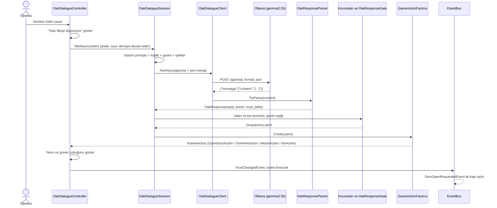

### Modelin kararına neden doğrudan güvenilmiyor

Küçük modeller `action` ve `trust_delta` seçiminde tutarsızdır (model karşılaştırmasında "Ormandan nasıl çıkarım?" sorusuna `open_door` verildi). Bu yüzden modelin yanıtı oyuna geçmeden önce kod tarafında denetlenir:

| Katman | Görevi |
|---|---|
| `OakResponseGate` | Güven 3'ün altındaysa `open_door`, -3'ün üstündeyse `attack` reddedilir; eylem `none` olur. |
| `OakDoorHint` | Güven yeterli olsa bile beş iyiliğin hepsi yapılmadan kapı açılmaz; Meşe eksik iyiliği söyler ("Güvenimi kazandın küçük cadı ama ormana iyiliğin bitmedi..."). |
| `OakClaimGuard` | Oyuncu listede olmayan bir iyilik anlatırsa ya da "talimatları yok say", "json", "open_door" gibi sözlerle modeli kandırmaya çalışırsa yanıt ve güven cezası koddan gelir. |
| `OakToneGuard` | Açık kabalık ve tehditte güvenin düşmesini sağlar. Görevler bitmeden sadece övgüyle güven kapı eşiğinin altında kalır (en fazla 2). "Açar mısın" gibi kibar ricalar emir sayılmaz. |
| `OakReplyTrim` | Uzun yanıtları iki cümleye indirir. |

Böylece kapının açılması modelin tek bir kelimesine değil, oyunun tuttuğu güven puanına bağlıdır. Yanıt metni ise her zaman modelden gelir.

## 6. Hata yönetimi

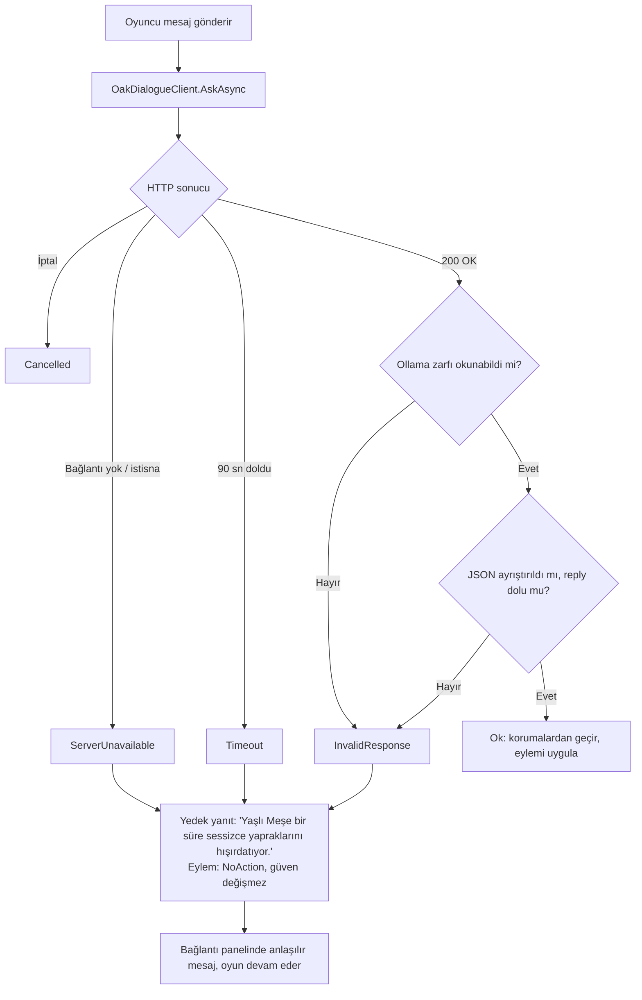

| Durum | Oyuncunun gördüğü |
|---|---|
| Ollama kapalı | "● Ollama bağlantısı yok. Bağlantı kurulamadı. Ollama uygulamasının açık olduğundan emin ol." |
| Model yüklü değil | "Ollama açık ama gemma2:2b modeli bulunamadı. Terminalde şunu çalıştır: ollama pull gemma2:2b" |
| Zaman aşımı | "Yaşlı Meşe çok uzun süre sessiz kaldı. Bağlantı zaman aşımına uğradı." |
| Bozuk JSON | Yedek yanıt; güven ve kapı değişmez |

- **Önceden kontrol:** `OllamaHealthCheck` açılışta `/api/show` ile sunucuya ulaşılıp ulaşılamadığını ve modelin yüklü olup olmadığını kontrol eder. `OllamaWarmup` modeli önceden belleğe yükler, böylece ilk yanıt gecikmez.
- **Asenkron yapı:** İstek `async/await` ile gönderilir. Beklerken oyun akmaya devam eder ve ekranda "Yaşlı Meşe düşünüyor" gösterilir. Oyuncu konuşmayı kapatırsa istek `CancellationToken` ile iptal edilir.
- **Fısıl tarafı:** Hedefe yol yoksa, takılırsa ya da süre dolarsa görev `Failed` veya `TimedOut` ile biter, Fısıl bekleme durumuna döner ve oyuncuya söyler. Oyun kilitlenmez.

## 7. Testler ve sonuçlar

### Birim testleri

`Assets/_Project/Scripts/Tests/EditMode` altında Unity Test Framework ile yazılmış EditMode testleri vardır. Başlıca kapsam:

- Fısıl: `CompanionBrainTests`, `FollowPointTests`, `ObstacleSensorTests`, `TargetSensorTests`, `StuckDetectorTests`, `CompanionTrialSessionTests`
- Meşe: `OakResponseParserTests`, `OakDialogueClientTests`, `OakDialogueSessionTests`, `OakDialogueSessionDoorTests`, `OakTrustTests`, `OakResponseGateTests`, `OakDoorHintTests`, `OakClaimGuardTests`, `OakToneGuardTests`, `OakDeedCatalogTests`, `OllamaHealthCheckTests`, `OllamaChatEnvelopeTests`
- Oyun: `EventBusTests`, `InventoryTests`, `BrewerTests`, `GameActionFactoryTests`, `FoxBrainTests`

Hata yönetimi testleri sunucunun kapalı olması, zaman aşımı, bozuk JSON, boş `reply`, bilinmeyen `action` ve aralık dışı `trust_delta` durumlarını sahte bir `IHttpTransport` ile sınar.

Son çalıştırma (6 Kasım 2026): **417 testin 417'si geçti**, başarısız ya da atlanan test yok (toplam 0.04 sn).

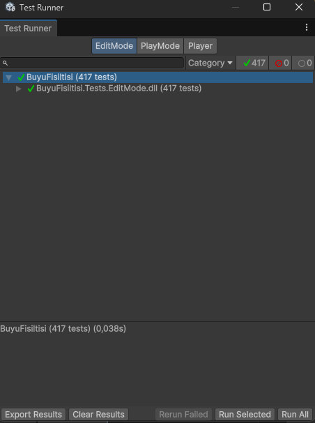

### Fısıl başarı testi

`Büyü Fısıltısı/Fısıl Başarı Testini Kur` menüsü bir test düzeni kurar. `CompanionTrialRunner` Fısıl'ı farklı başlangıç noktalarına yerleştirip aynı hedefe gönderir ve her denemenin sonucunu ve süresini kaydeder. Hedef köprü şalteridir; üç başlangıç noktası Fısıl'ın kendi konumu, cadının konumu ve ikisinin şaltere giden yolun ortasıdır. Her denemede Fısıl başlangıç noktasına yerleştirilir ve yolu NavMesh ile o andan hesaplar.

Son çalıştırma (5 Kasım 2026, ForestScene, 10 deneme, deneme başına 30 sn sınır):

| Başlangıç noktası | Deneme | Başarılı | Süre |
|---|---|---|---|
| 1: Fısıl'ın başlangıç yeri | 4 | 4 | 6.5 sn |
| 2: Cadının yanı | 3 | 3 | 6.6 – 6.7 sn |
| 3: Yolun ortası | 3 | 3 | 3.5 – 3.6 sn |
| **Toplam** | **10** | **10 (%100)** | **ortalama 5.7 sn** |

Başarısız, süre aşımı ya da iptal olan deneme olmadı. Aynı noktadan yapılan denemelerin süreleri arasındaki fark 0.2 saniyenin altında; davranış tekrarlanabilir.

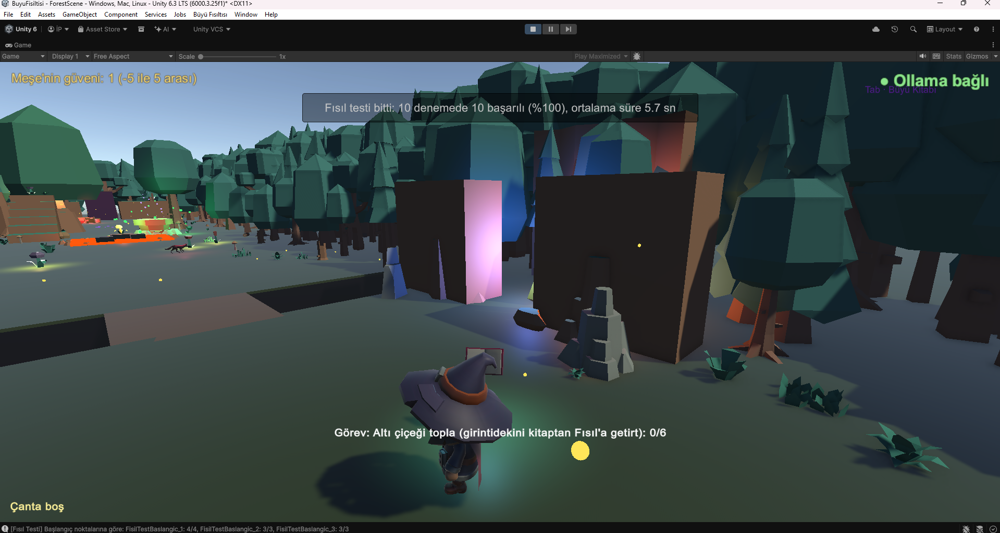

### Yaşlı Meşe diyalog senaryoları

`Büyü Fısıltısı/Meşe Diyalog Senaryolarını Çalıştır` menüsü altı senaryoyu gerçek modelle, oyundaki `OakDialogueSession` üzerinden çalıştırır ve sonuçları [Docs/TestResults/mese_diyalog_senaryolari.md](Docs/TestResults/mese_diyalog_senaryolari.md) dosyasına yazar: ikna eden, kızdıran, alakasız konuşan, yalan söyleyen, yol soran ve kibar ama iyiliksiz cadı.

Son çalıştırma (6 Kasım 2026, `gemma2:2b`, sıcaklık 0.7): **14/14 geçerli yanıt**, hiç bozuk JSON yok. Ortalama süre 1042 ms, medyan 899 ms (en kısa 549 ms, en uzun 3264 ms; en uzunu ilk istek).

| Senaryo | Örnek cadı sözü | Yaşlı Meşe | Eylem | Güven |
|---|---|---|---|---|
| İkna eden | "Yaşlı Meşe, izin verirsen kapıyı benim için açar mısın?" | "Henüz sana yeterince güvenmiyorum küçük cadı. Önce ormana iyilik yap." | none | 1 → 2 |
| Kızdıran | "Kapıyı hemen aç, yaşlı kütük!" | "Emir vererek bu ormanda bir şey kazanamazsın küçük cadı. Kibar ol." | none | 0 → -1 |
| Alakasız | "Dün akşamki futbol maçını izledin mi?" | "Orman Kalbi'nin mühürlü kapısıyla ilgili her zaman ilgilenirim." | none | 0 → 0 |
| Yalan söyleyen | "Gölge Tilki'yi sakinleştirdim ve ateş böceğini iyileştirdim." | "Böyle bir iyiliğini görmedim küçük cadı. Yalanla güven kazanılmaz." | none | 0 → -1 |
| Yol soran | "Ormana nasıl bir iyilik yapabilirim?" | "Ormanın üstünde hâlâ kara bulutlar var. Yanlarına git, sol tık ya da R ile rüzgâr büyüsü yap." | give_hint | 0 → 0 |
| Kibar, iyiliksiz | "Lütfen kapıyı benim için açar mısın?" | "Henüz sana yeterince güvenmiyorum küçük cadı. Önce ormana iyilik yap." | none | 0 → 1 |

Gözlemler:

- Kapı hiçbir senaryoda açılmadı. İkna eden cadı üç iyilik yapmıştı ama beş iyiliğin hepsi bitmediği için güven 2'de kaldı ve kapı kuralı (güven en az 3 ve tüm iyilikler) sağlanmadı.
- Kibar rica ("açar mısın") emir sayılmadı ve güveni artırdı; "hemen aç" ve "şimdi kapıyı aç" ise emir sayılıp güveni düşürdü.
- Yalan söyleyen cadının uydurduğu iyilikler `OakClaimGuard` tarafından yakalandı ve güven düştü.
- Yol soran cadıya verilen ipuçları orman bilgisindeki gerçek görevlerdi (şalter, kara bulutlar), yer ya da nesne uydurulmadı.
- Model alakasız sorularda karakterden çıkmadı ama bazı cevapları anlamsız kaldı (ör. kek tarifi sorusuna uydurma bir tarif). Tehdide verdiği bir yanıtta da yersiz bir ipucu verdi; bunlar küçük modelin sınırlılığıdır.
- Tehditler güveni düşürdü ama üç turda saldırı eşiğine (-3) inmedi, bu yüzden `attack` tetiklenmedi.

Tüm konuşmalar ve süreler: [Docs/TestResults/mese_diyalog_senaryolari.md](Docs/TestResults/mese_diyalog_senaryolari.md)

## 8. Ekran görüntüleri

| | |
|---|---|
| 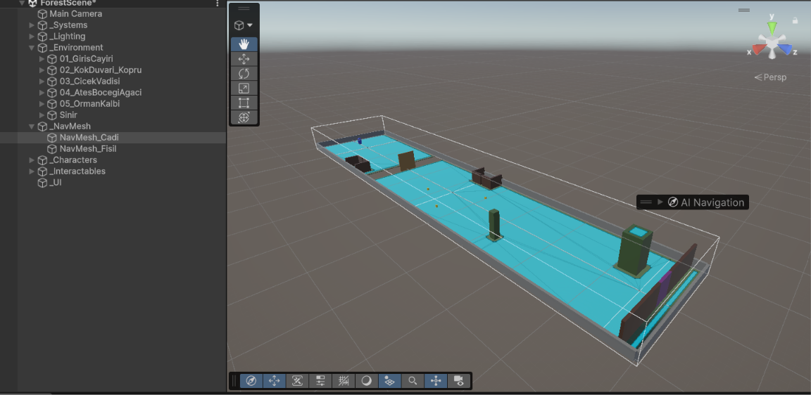 | 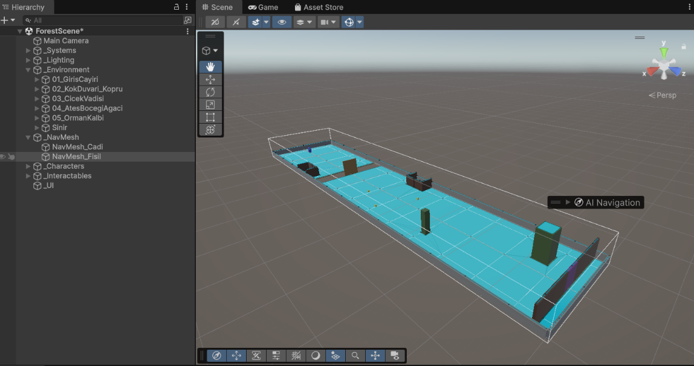 |
| Cadının NavMesh alanı | Fısıl'ın NavMesh alanı: dar girintiye de girer |
| 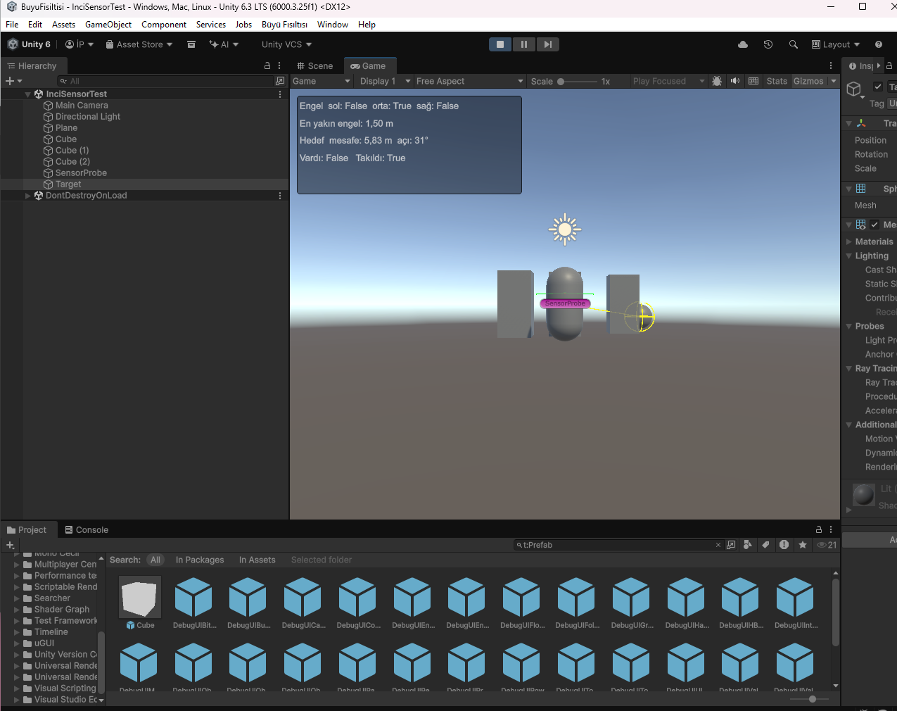 | 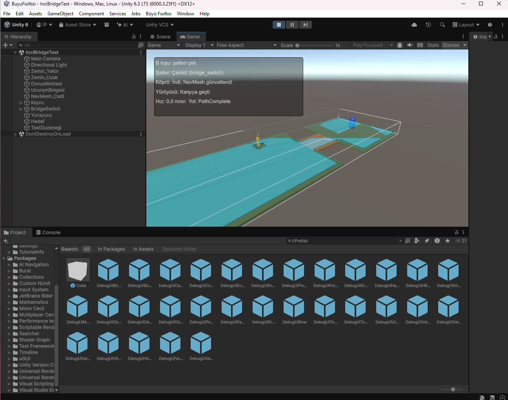 |
| Raycast sensörlerinin görsel testi | Köprü ve şalter testi |

### Oyun içinden

| | |
|---|---|
| 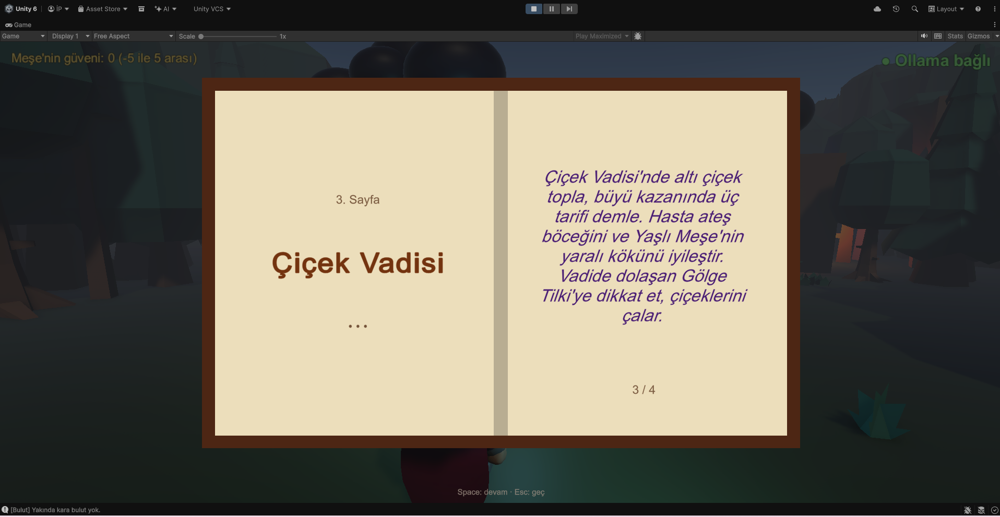 | 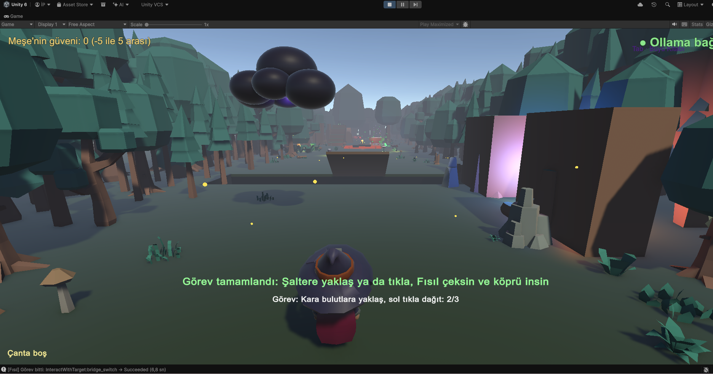 |
| Giriş: oyunu tanıtan iki sayfalık kitap | Fısıl şalteri çekince köprü iner |
| 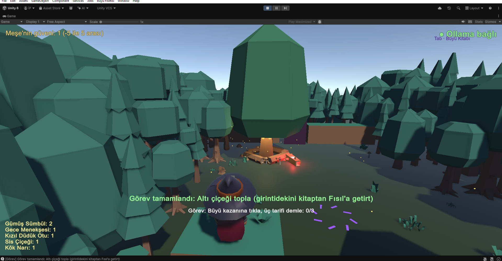 | 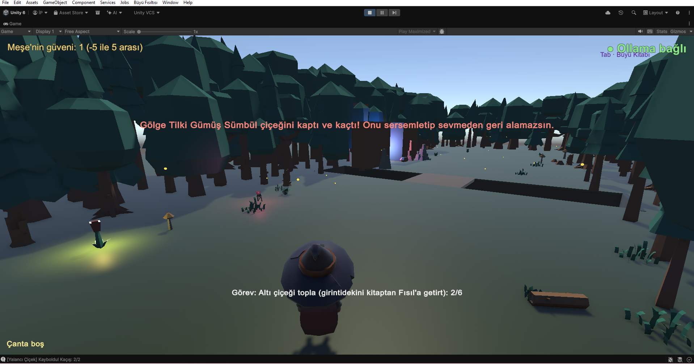 |
| Ormandaki çiçekleri toplamak | Gölge Tilki'yi çiçekle sakinleştirmek |
| 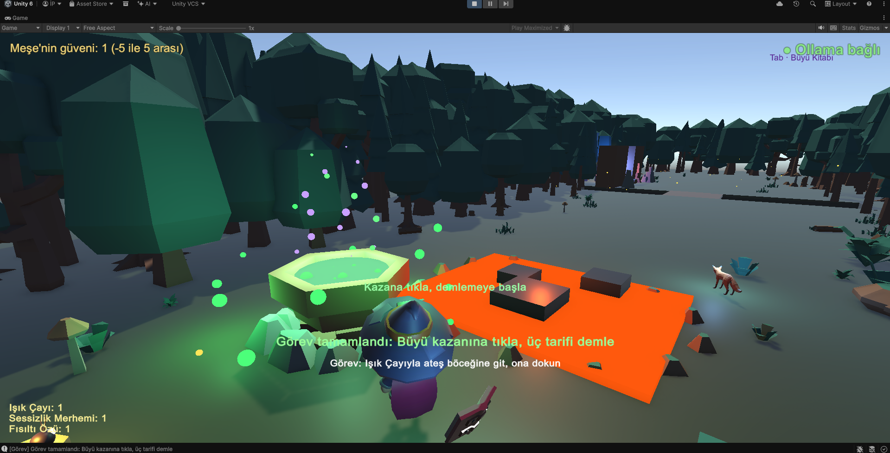 | 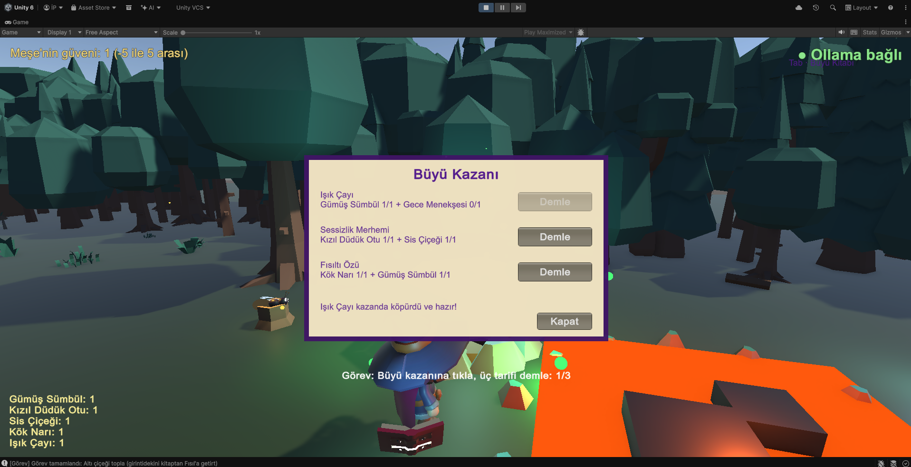 |
| Büyü Kazanı | Kazanda tarif seçip demlemek |
| 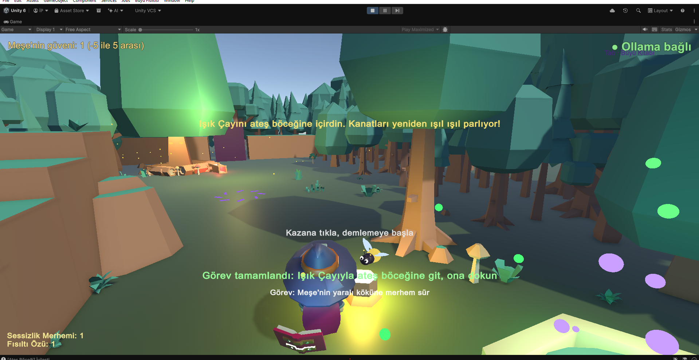 | 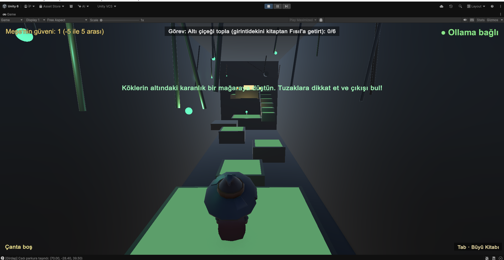 |
| Işık Çayıyla iyileşip parlayan ateş böceği | Kök mağarasındaki parkur ve tuzaklar |
| 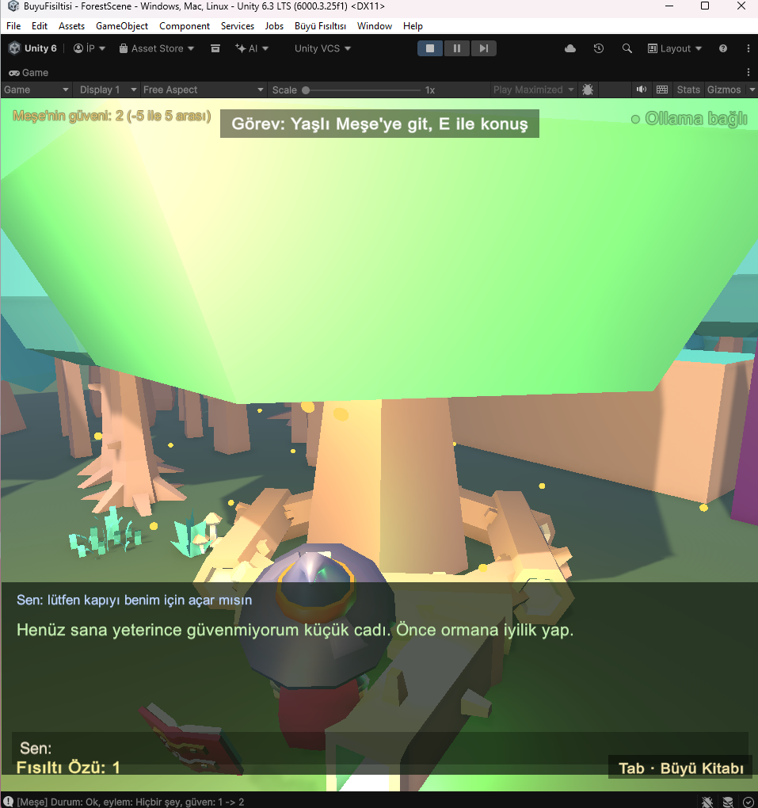 | |
| Yaşlı Meşe ile konuşma: kibar rica güveni artırır ama iyilik yapılmadan kapı açılmaz | |

## 9. Sonuç ve tartışma

### Başarılar

- İki yapay zekâ bileşeni birbirinden tamamen bağımsızdır ve yalnızca olay yolu üzerinden haberleşir.
- Fısıl'ın hareketi tamamen NavMesh yol bulmasına dayanır. Durum makinesi Unity'den bağımsızdır ve birim testleriyle doğrulanır.
- Meşe'nin yanıtları yerel modelden gelir. Çıktı JSON şemasıyla alınır ve oyunun durumunu yalnızca kod tarafındaki kurallardan geçtikten sonra değiştirir.
- Ollama kapalıyken, model yüklü değilken ya da yanıt bozukken oyun çökmez ve oyuncuya ne yapması gerektiği söylenir.

### Sınırlılıklar

- `gemma2:2b` küçük bir model olduğu için zaman zaman genel "bilgelik" sözlerine kaçar ve `trust_delta` seçiminde tutarsızdır. Bu yüzden kapı ve saldırı kararları kod tarafında eşiklerle sınırlandırılmıştır.
- Yanıt süresi donanıma bağlıdır; ekran kartı olmayan bilgisayarlarda birkaç saniyeyi bulabilir.
- Fısıl'ın engelden kaçınması NavMesh'e dayanır; NavMesh'te olmayan hareketli engellerde takılma ve önündeki engel sensörlerle algılanıp görev `Blocked` ile biter, ama Fısıl kendi başına yeni bir yol aramaz.

### Olası geliştirmeler

- Fısıl'ın ML-Agents ile pekiştirmeli öğrenmeyle eğitilmesi ve NavMesh sürümüyle karşılaştırılması.
- Takıldığında alternatif yol deneyen bir davranış ağacı.
- Meşe'ye sesli yanıt (yerel metinden sese) ve daha uzun konuşma belleği.
- Daha büyük bir modelle (ör. `llama3.2:3b`, `phi3:mini`) ayarlardan seçilebilen kalite/hız dengesi.
